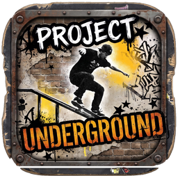
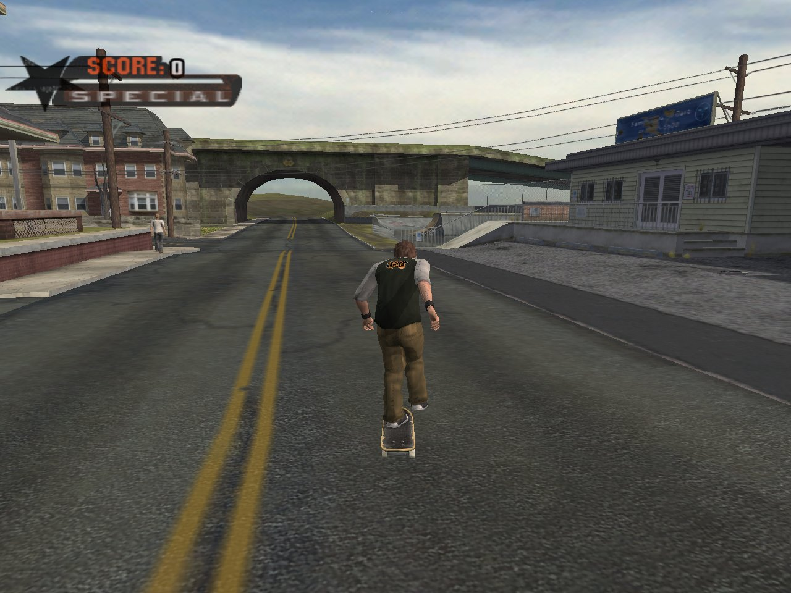
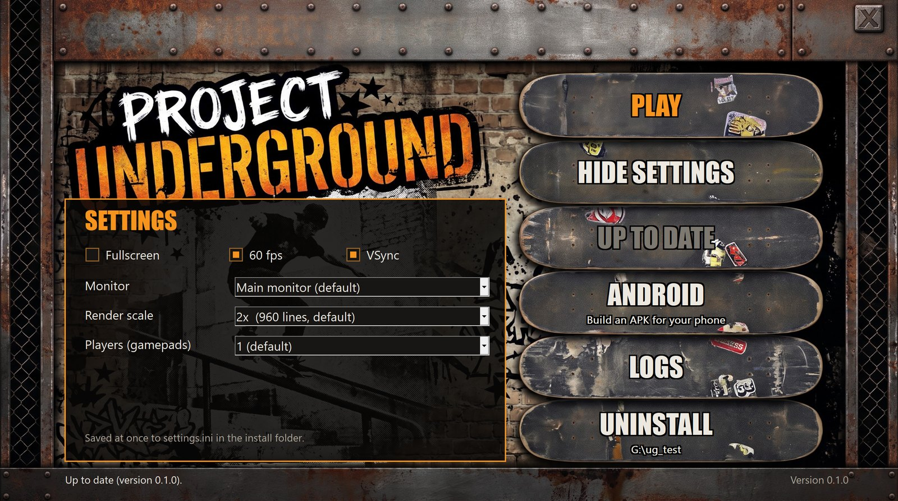

<div align="center">



# Project Underground

**Tony Hawk's Underground (Xbox) rebuilt as a native game for Windows, Linux and Android.**

[](#status)
[](#status)
[](#status)
[](#how-it-works)
[](#features)
[](#status)

A static recompilation by 8gram Labs: the original x86 game code is translated to C and compiled natively for
64-bit Windows, Linux and Android phones, with its own Vulkan renderer, higher resolutions, 60 fps and a launcher.


</div>

> No game code or data ships with this project. The installer builds the game **on your PC from your own
> Tony Hawk's Underground (Xbox, USA) disc image**.

> [!IMPORTANT]
> **No download yet.** The first release ships when the Windows, Linux and Android builds are all ready
> together. Windows and Linux are playable today. The Android build still has to be tested on a real phone.
> Developers can [build it from source](#building-from-source-developers) now.

<div align="center">




</div>

## Features

- **Native builds, no emulator.** Every function of `default.xbe` is lifted to C and compiled for the machine it
  runs on: 64-bit Windows, Linux (x86-64) and Android (arm64).
- **Own Vulkan renderer.** The Xbox GPU's (NV2A) push buffer goes straight to Vulkan on every platform: vertex
  programs and register combiners run as shader interpreters, with shadow maps, fog and texture generation. No
  Direct3D, no DXVK.
- **High resolution.** The game renders at a multiple of the Xbox's 480 lines: 2x (960 lines) by default, up to 6x.
- **60 fps.** Frames are paced at 60 fps (the launcher can switch to 30), with VSync on or off.
- **Launcher.** Play, display settings (fullscreen, monitor, render scale, players), updates, logs, the Android
  build and uninstall, all on one screen.
- **Builds on your PC, no Visual Studio.** The setup fetches its own compiler (llvm-mingw, about 190 MB, once) and
  builds the game in about a minute. No admin rights needed.
- **Linux.** The same renderer on Vulkan, SDL3 for the window, sound and controllers, and a `setup.sh` installer
  with menu entry, updates and uninstall.
- **Android.** Your PC turns your installed game into an APK for your phone (arm64, Android 13+, Vulkan 1.3), with
  on-screen touch controls.
- **Controllers and keyboard.** XInput pads on Windows, SDL3 gamepads on Linux and Android, up to 4 players.

## The installer and launcher

| Setup | Launcher | Launcher settings |
|---|---|---|
|  |  |  |

The skateboards are the buttons. Setup: choose your disc image and install folder, then **Install**. Updates
rebuild the game in place and keep your saves and settings.

## Status

| Area | State |
|---|---|
| Boot, Activision/Neversoft/intro movies (Bink), title menus | Working |
| Story mode: intro cutscene, Create-a-Skater, New Jersey level | Working, skater controllable, HUD, 60 fps |
| Saves, loading, cutscene streaming | Working |
| Sound, music, movies | Working (DirectSound mixed in software) |
| Renderer: textures, combiners, fog, shadow maps, texgen, depth clamp, polygon offset | Working |
| Other levels | Not checked yet: renderer gaps (FF lighting, cube maps, some texgen modes, widescreen) may show up |
| Installer, launcher, updates, uninstall (Windows) | Install, update and uninstall tested |
| Linux | Boots to New Jersey gameplay; install, update, uninstall and the updater tested (Ubuntu 24.04, WSL) |
| Android | APK builds and signs on Windows and Linux; not yet run on a phone |
| PS2 HD Remaster textures | Planned (last step) |

Known gaps:
- A translucent dark band sometimes crosses the sky (cosmetic).
- Only the first levels have been played so far; later levels may need renderer work.
- Not yet tested on a clean PC, on a real Linux GPU, or with real controllers on Linux.

## Controls

| Xbox pad | Keyboard |
|---|---|
| D-pad | Arrow keys |
| Left stick / right stick | W A S D / I J K L |
| A / B / X / Y | Z / X / C / V |
| Black / White | F / G |
| LT / RT | Q / E |
| START / BACK | Enter / Backspace |
| | F11 or Alt+Enter: fullscreen, Esc: quit |

## How it works

- `recomp/lift.py` translates the x86 code of `default.xbe` to C: 12,927 functions (96% of `.text`), including
  the SSE and x87 code. A differential oracle compares lifted functions with an emulator run on the original bytes
  (2,228 pass; every failure is explained and none is a lifter bug).
- `runtime/` holds the Xbox kernel, file system, threads and fibers, XInput and DirectSound HLE, and the NV2A
  push-buffer to Vulkan renderer (`runtime/src/gpu_vulkan.c`, shaders in `runtime/shaders/`).
- `installer/` holds the setup and launcher (one Win32 exe built with llvm-mingw), and `tools/ug_build.py` runs the
  on-PC build: extract, check the disc, translate, compile, link.
- Linux and Android use the same runtime through a small Win32 compatibility layer (`runtime/src/linux/`) and SDL3.
  `tools/ug_android.py` builds the APK on the player's PC from a template APK that holds no game code.

See [docs/installer.md](docs/installer.md) for the installer, launcher, Linux and Android details.

## Building from source (developers)

Requirements: Python 3 with `capstone` (`pip install capstone==5.0.7`) and your disc image. No Visual Studio, no Windows SDK, no Vulkan SDK: the compiler
(llvm-mingw) is fetched for you.

```bat
python -I tools\ug_build.py --root <build folder> --iso "<path to your disc image>"
<build folder>\underground.exe
```

This is the same build the installer runs. `python -I installer\build.py` packages
`dist\ProjectUnderground-Setup-<version>.exe`. Linux: `tools/build_linux.sh` and `tools/package_linux.sh`.

## Legal

Tony Hawk's Underground is a trademark of its owners. This project is not affiliated with or endorsed by them. It
contains no game code, data or assets. You need your own copy of the game.
